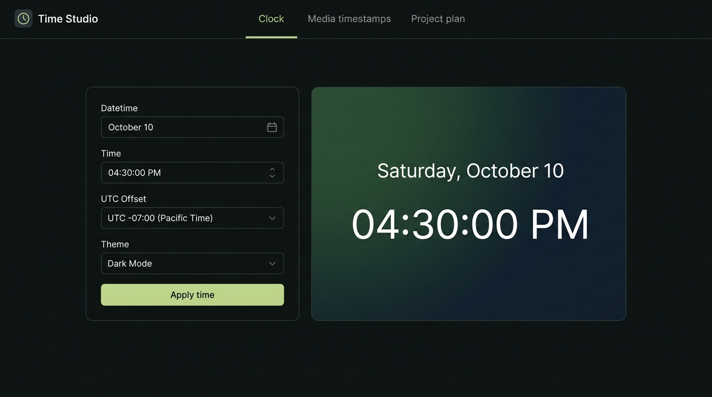
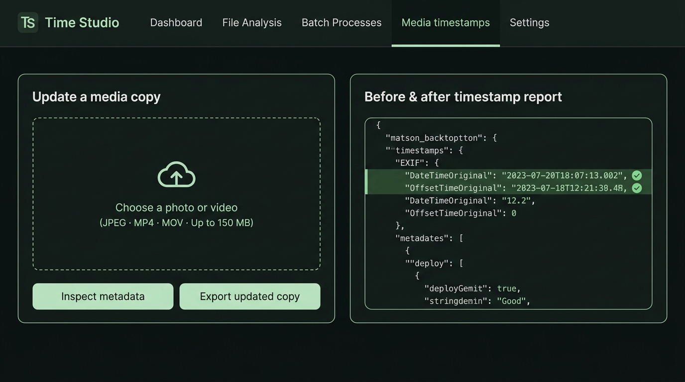

# Time Studio

A local project with a configurable clock display and a photo/video timestamp editor. The clock uses an original, minimal phone-friendly design. It is a webpage, not a replacement for the device lock screen or system clock.



## First release

- Choose a date, time, and explicit UTC offset.
- Display a frozen clock or a clock that advances from the chosen time.
- Switch 12/24-hour format, seconds, and visual themes.
- Open a clean clock presentation; fullscreen depends on browser support.
- Upload a JPEG, MP4, or MOV locally, inspect metadata, and export a copy with supported timestamp fields changed.
- Download a before/after report showing the actual fields and verification results.
- Keep source files unchanged. Location editing is not included.

## Run

Install Python 3.10 or newer, then run from this directory. No Python packages or ExifTool installation are required:

```sh
python3 server.py
```

Open the local address printed in the terminal. On Windows, use `py server.py` if that is your Python launcher. If ExifTool is already installed on PATH (or selected through the EXIFTOOL environment variable), the server uses it automatically. Otherwise it uses the included pure-Python editor.

The clock also works by opening `index.html` in a browser. Metadata processing requires the Python server; a built-in editor works without ExifTool. The server binds to localhost: it is for use on the same computer and is not a publicly hosted service. A phone cannot reach your computer's localhost address. For phone use, open the HTML in a browser that supports local HTML, or deploy the clock frontend to an HTTPS static host in a later phase. Phone file viewers may preview HTML without running JavaScript.

## Workflow

1. Set the intended wall-clock date and time. Enter the UTC offset for that date, for example `-04:00` for New York during daylight saving time or `-05:00` during standard time.
2. Pick frozen or advancing mode, format, and appearance. Switching to held mode pauses the current clock; switching back resumes it. Apply time resets the display to the selected form timestamp. Media exports always use that explicit form timestamp, not the ticking display. Open the clock presentation. Tap to exit or press Escape.
3. In the metadata editor, choose a supported file and inspect it.
4. Export a copy using the selected timestamp. Review the verification result and field changes before downloading.
5. Keep the original and the JSON change report with the exported copy.



Changing controls does not change the device clock. An explicit offset avoids silently interpreting a requested time in the server's timezone. The current release does not calculate daylight-saving rules for named cities.

## Timestamp scope and limitations

JPEG has EXIF date fields and may also contain XMP, manufacturer fields, GPS timestamps, and other records. MP4/MOV can contain container, track, media, and vendor-specific timestamps. This app updates a declared set of supported fields and reads the result back. It does not claim to rewrite every date embedded in every possible file format.

File creation/modification dates shown by an operating system, download dates, cloud upload times, photo-library database dates, filenames, visible date text inside pixels, and external service logs are distinct from embedded media timestamps. A browser download may get a new filesystem timestamp. This tool does not control those external records, attest attendance, or establish where or when something happened.

Video timestamps require careful UTC conversion. Integer QuickTime date fields are conventionally UTC; the display time and offset are converted to the same instant. Video frames and audio are not re-encoded. Existing location information is outside the editing scope and may remain in uploaded files.

Supported inputs in this release: JPEG, MP4, MOV. PNG, HEIC, RAW, Live Photo pairs, and arbitrary videos are not supported. Uploads are limited to 150 MiB. Files are processed locally in temporary storage; download results before stopping the server. Do not expose this development server directly to the internet.

## Project plan

### Phase 1 — Clock and timestamp editor (implemented)

Architecture: one dependency-free HTML/CSS/JavaScript frontend, a Python standard-library HTTP server, and an included format-specific metadata editor. ExifTool is used if already available but is optional. The frontend stores the selected clock state separately from actual system time. The backend accepts a multipart upload, inspects the format, writes to a temporary copy, reads metadata back, and returns downloads plus a change report. Random identifiers isolate uploaded files and prevent filenames from becoming filesystem paths.

The clock uses large tabular numerals, restrained typography, and simple backgrounds. Fullscreen is requested from a user gesture; a full-window presentation remains available when the browser refuses fullscreen. It does not impersonate operating-system security controls.

Acceptance criteria: clock formats render correctly; freeze does not drift; advancing time crosses midnight; explicit offset survives export; supported timestamp fields verify; source bytes remain unchanged; image pixels and video/audio payloads remain unchanged; malformed files and unsupported types return useful errors.

### Included editor details

The JPEG editor replaces or inserts the EXIF APP1 segment without decoding or recompressing the image. It keeps existing TIFF data at its original relative offsets, appends updated directories, and points the EXIF header at them. Active original/create/modify date fields and their UTC offsets are updated; active fractional-second fields are removed. Existing camera, orientation, GPS, and thumbnail entries are preserved. Superseded values can remain in unreferenced bytes: this is a timestamp editor, not a data-erasure tool. Near-full EXIF segments and malformed files are rejected instead of silently dropping metadata.

The MP4/MOV editor updates fixed-size numeric creation/modification fields in movie (`mvhd`), track (`tkhd`), and media (`mdhd`) headers. Atom sizes, media bytes, and durations stay unchanged. It supports version 0 and version 1 headers. Dates that exceed a version 0 field's 32-bit range are rejected rather than wrapping; a typical version 0 file cannot represent a date after February 6, 2040 UTC. Existing textual QuickTime/Keys, XMP, manufacturer, and GPS timestamps remain outside the built-in writer's scope and may differ from the edited values.

The report identifies the engine and every verified field. The built-in reader lists its supported time fields; it is not a complete metadata inventory. When installed, ExifTool provides a broader timestamp inspection and also writes `Keys:CreationDate` for video.

### Phase 2 — Phone deployment and broader timestamp support

1. Deploy the clock frontend over HTTPS and add an installable PWA manifest, offline caching, icons, and optional screen-wake handling.
2. Validate on physical iPhone Safari and Android Chrome. Browser fullscreen and home-screen behavior must be tested on each supported platform.
3. Add named IANA timezones with explicit handling for ambiguous/nonexistent daylight-saving times.
4. Add batch correction and relative-shift mode to preserve intervals between files.
5. Expand formats one at a time, starting with HEIC. Document exactly which tags are written and add independent readback and media-integrity tests for each format.
6. Add a packaged desktop launcher so users do not need to manage Python themselves. Keep media processing local by default.

### Phase 3 — Optional location metadata correction (planned only)

Add a coordinate picker, optional place search, coordinate preview, and an explicit before/after review. Keep location independent of the selected timestamp. Start with JPEG EXIF latitude/longitude and their reference fields, then evaluate XMP and format-specific QuickTime location fields. Preserve altitude unless explicitly edited; report contradictory or unsupported existing location fields instead of silently claiming complete coverage.

Location metadata edits would describe a chosen coordinate in a file. They would not change a device's live GPS position, network location, service records, or the visible scene. No location code, GPS spoofing, or device location override is implemented in this release.

### Phase 4 — Optional shared service

If a hosted uploader is needed, replace the development server with a production application, authenticated sessions, bounded job queues, streaming uploads, per-user storage isolation, job expiry, TLS, and explicit retention controls. Add resource limits around metadata parsers and a supported dependency-update process. This is a separate deployment project.

## Sources

- [Apple movie header documentation](https://developer.apple.com/documentation/quicktime-file-format/movie_header_atom): numeric movie creation and modification fields.
- [ExifTool QuickTime tag documentation](https://exiftool.org/TagNames/QuickTime.html): writable video tags and UTC interpretation.
- [ExifTool FAQ](https://exiftool.org/faq.html): common date tags and the distinction between metadata and filesystem timestamps.
- [ExifTool installation](https://exiftool.org/install.html): platform setup.
- [MDN Fullscreen API guide](https://developer.mozilla.org/en-US/docs/Web/API/Fullscreen_API/Guide): browser fullscreen behavior.

See `TESTING.md` for the checks performed on this build and remaining device-specific validation.
